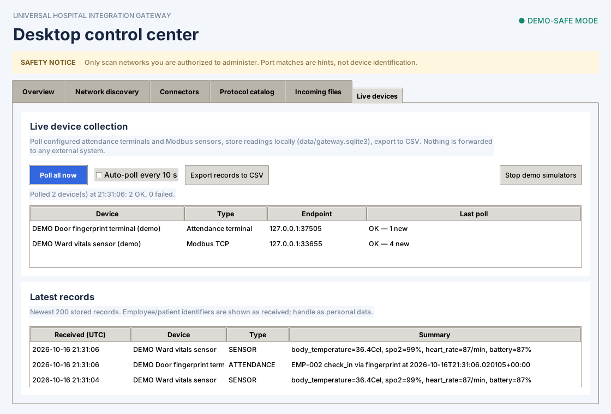

# Universal Hospital Integration Gateway — Desktop Foundation

A Windows-first native desktop app for authorized endpoint discovery, connector configuration, incoming JSON/CSV/XML file preview, and protocol integration planning. The existing desktop interface is retained and the source tree adds service, domain, connector, pipeline, storage, security, and test modules for incremental development.

## Important status disclosure
This is **not a certified medical device and not a universal proprietary-protocol decoder**. Network discovery detects reachable ports only; it cannot establish device identity or data compatibility. The UI's protocol catalog contains hints and scaffolds. FHIR metadata check, if selected in the UI, is read-only. HL7 v2, DICOM, Modbus, OPC UA, and vendor SDK modules are extension points and are not production integrations. No external clinical delivery is enabled by this foundation.

## Run
1. Extract the ZIP to a writable folder.
2. Install Python 3.11+ for Windows with Tcl/Tk.
3. Double-click `Start_Hospital_Gateway.bat`.

Or run PowerShell from the project root:
```powershell
$env:PYTHONPATH = "$PWD\src"
py -3 -m hospital_gateway
```

## Build EXE
Double-click `Build_Windows_EXE.bat`. It installs PyInstaller and builds `dist\UniversalHospitalGateway.exe`. Internet access is needed for build dependencies; the ZIP does not contain a prebuilt EXE.

## Safety
- Use only an isolated sandbox network or ranges you have explicit permission to scan.
- Keep RDP restricted to a known admin IP; do not expose test ports publicly.
- Do not use patient data in demos or logs.
- Use synthetic data and validate each adapter against documented interfaces and simulators before any clinical environment.
- Treat open-port results as unverified hints, not device identification.
- Store credentials in Windows Credential Manager or a managed vault; never commit secrets.

## Architecture
`desktop/` native UI; `application/` use-case services; `domain/` models and policies; `discovery/` bounded network scanning; `connectors/` protocol adapters; `pipeline/` parsing and normalization; `destinations/` outbound adapter contracts; `storage/` SQLite/config; `security/` credential/access/audit policies; `infrastructure/` logging/time/retry utilities.

The desktop screens are currently composed in `desktop/app.py`; `desktop/views/` files are extraction points for a later UI refactor. This is a functional starter, not a claim that every module in the target architecture is complete.

## Live devices tab
In the app, open **Live devices**: add an *Attendance terminal* or *Modbus TCP* connector (Modbus needs the vendor's register map as JSON), press **Poll all now** or tick auto-poll (10 s), watch records arrive, and **Export records to CSV** (written to `exports/`). **Start demo simulators** adds a simulated fingerprint terminal and vitals sensor so you can try everything without hardware. Data stays in `data/gateway.sqlite3`; nothing is forwarded to external systems.



Test evidence: [docs/TEST_REPORT.md](docs/TEST_REPORT.md).

## Demo devices (no hardware needed)
```
PYTHONPATH=src python -m hospital_gateway.demo      # PowerShell: $env:PYTHONPATH="$PWD\src"
```
Starts a **simulated** Modbus TCP vitals sensor and a **simulated** fingerprint attendance terminal on loopback (synthetic data), pulls from both, stores results in SQLite, and shows incremental polling and de-duplication. The Modbus client speaks real Modbus TCP, so it can be pointed at a real sensor with its documented register map. The attendance protocol (`SIM-ATT/1`) is a demo format: real terminals (ZKTeco, Suprema, Hikvision, etc.) need an adapter written from the vendor's SDK/protocol docs, and employee attendance data is personal data, so get authorization first.

## Tests
Install test dependencies and run:
```powershell
py -3 -m pip install -e ".[dev]"
py -3 -m pytest
```
106 tests cover file readers (incl. UTF-16 XML entity bypass), scope validation, real-socket port scanning, SQLite persistence, pipeline/services, FHIR failure handling, and the Tk desktop app (`tests/gui`, skipped automatically when Tk or a display is unavailable; on Linux use `xvfb-run pytest`).

## Changelog 0.3.1 (+ device demo)
- Security: XML DTD/entity blocking now works for every encoding (was bypassable with UTF-16); the desktop preview now uses the same hardened, size-limited parsers instead of its own.
- Security: scan scope also rejects `0.0.0.0/8`; desktop scan reuses `validate_cidr`.
- Fixed: SQLite connections were never closed (file locks on Windows); `Database.connect()` now commits/rolls back and closes.
- Fixed: the 5-second auto-refresh cleared the selected discovery row before "Configure" could be clicked.
- Fixed: a crashed scan left the Scan button disabled forever; worker threads now hand results to the UI thread through a queue.
- Fixed: a corrupt `config.json` was silently overwritten on next save; it is now preserved as `config.corrupt-<time>.json`. Config writes are atomic.
- Fixed: FHIR check no longer raises on connection resets/non-object bodies and refuses HTTPS-to-HTTP redirects. A "Test FHIR /metadata" button is now in the Connectors tab.
- Fixed: logs/data location no longer depends on the launch directory.
